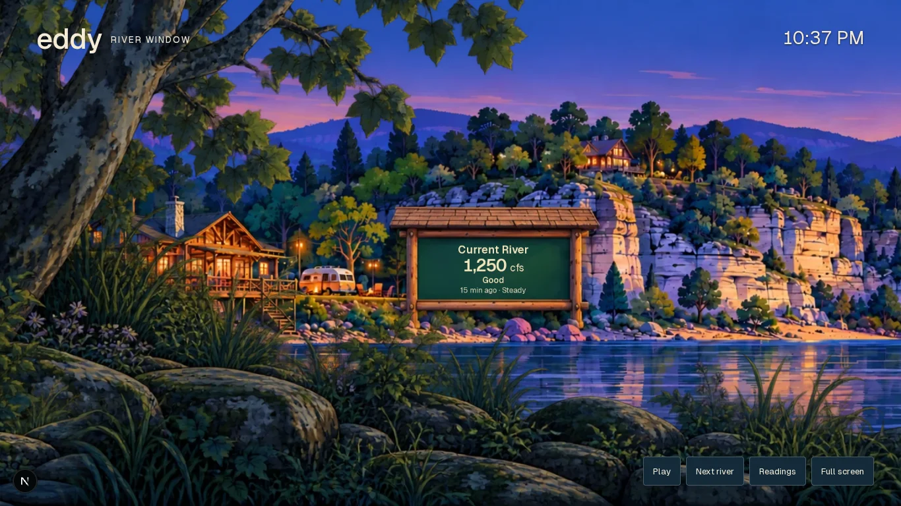

# River Window

`/embed/display` is a landscape, ambient river display. It is an independent
replacement for the display proposed in PR #1506; it does not include that
PR's admin visual-guide gallery.

The capture above is the actual route in Chromium with test readings, not
a separate design mockup. Runtime readings come from `/api/rivers`.

Open `/embed/display?rivers=current,jacks-fork,eleven-point` on a landscape
screen. Optional parameters: `name` (up to 50 characters) and `motion=off`.
The default rivers are Current, Jacks Fork and Eleven Point. Explicit unknown
slugs show an empty state; they never silently select a different river.

## Behavior

- Remotion Player drives the scenery at 30fps. The illustrated kiosk and its
  live text share the exact same transform. Readings are occasional; quiet
  stretches without data are intentional.
- Each kiosk pass selects the next river. Six passes close the full loop.
  The panorama is not mirrored. Its edges overlap by 80px and cross-blend;
  the vegetation moves at 1.5 times the riverbank speed.
- The `/api/rivers` snapshot refreshes every five minutes. Readings use the
  declared rating unit and shared condition definitions. A failed request
  preserves the last successful snapshot, visibly marks the interruption,
  and continues aging readings. Stale/unknown-time readings do not retain
  positive condition or trend guidance.
- High/flood conditions additionally remain visible outside the passing sign.
- Reduced motion starts paused. Pause, Next river, Readings and Full screen
  are keyboard accessible. Opening Readings pauses movement; this table is
  also the readable alternative on small screens. Hidden tabs pause motion.
- No illustrative data is substituted when the API fails. The artwork is
  fictional Ozark scenery, not a geographical model or a measured water level.

## Assets and maintenance

The two WebP assets in `public/display/river-window/` are generated artwork
created for this feature. `panorama.webp` includes a blank timber kiosk;
`foreground.webp` has alpha transparency. Live information is separate text.
They are served locally with the application; no generated-image URLs or
conversation-only files are required at runtime.

`src/components/display/RiverWindowScene.tsx` is the frame-driven composition.
Its props contain only display-ready readings and loading state. The web
route owns fetching, failure states and controls. `src/lib/display/river-window.ts`
owns unit/freshness decisions and loop geometry.

The kiosk text rectangle in `river-window.module.css` is calibrated to this
panorama. When replacing the art, update that rectangle and inspect the actual
route at 1920×1080 and 1366×768. Avoid adding large dashboard panels above the
scenery. Remotion and its player are pinned to the repository's existing video
project version, 4.0.242; they are lazy-loaded only for this route.

Validation: `make check-web`; `node scripts/check-river-window.mjs` starts its
own development server. Browser checks intercept `/api/rivers` with test
fixtures; they do not query or mutate production data. `CHROMIUM_EXECUTABLE_PATH`
can select an existing Chromium installation. Set `DISPLAY_TEST_BASE_URL`
to use an already-running server instead; otherwise the script uses port 3200.
