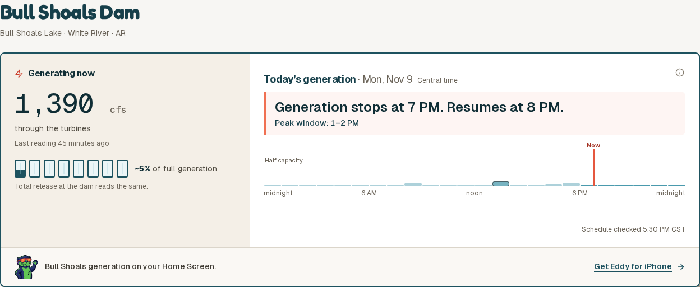
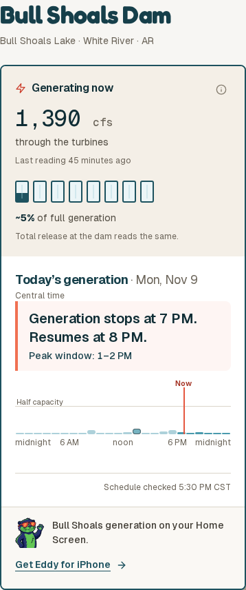

# Dam timing banner and low-output schedule

These screenshots render the real GenerationCard, GenerationSchedule and DamTimeline components with Eddy’s existing Tailwind styles, fonts and icons. They are component checks, not captures of a deployed site.

The normal case uses the Bull Shoals API snapshot retrieved Nov 9 at 6:52 PM Central, with the display clock fixed at 6:45 PM. Its posted schedule was independently checked against [SWPA’s Monday sheet](https://www.energy.gov/swpa/mon.htm), dated November 9, 2026 (that URL rotates weekly). HE14 is 40 MW and means 1–2 PM Central. The dam’s scheduling capacity is 391 MW.

## Verification

- All 5,046 registered web/Today tests, both TypeScript checks, ESLint and the design-token checks passed. ESLint has 18 existing warnings. Node 20 ran the registered test commands with `node --import tsx` because the tsx CLI cannot create its IPC socket in this environment.
- Component browser checks passed at 1440, 768, 390 and 320 px: coral callout, no horizontal overflow, distinct actual bar heights, mouse/touch/keyboard hourly readouts, split peaks, minimum-flow, idle, missing and partial schedules. The extra states are synthetic variations of the captured schedule.
- The 7, 15, 30 and 40 MW bars render at 2, 3.06, 6.13 and 8.17 px in the 80 px plot; the peak remains 10.23% of the fixed capacity scale. Previously all four rendered at 9.6 px.
- The full Next development-server check did not complete reliably in this environment. Screenshots and interaction checks use an isolated browser harness with the actual components and CSS; deployed route/navigation verification is not claimed.

## Desktop

## Phone

