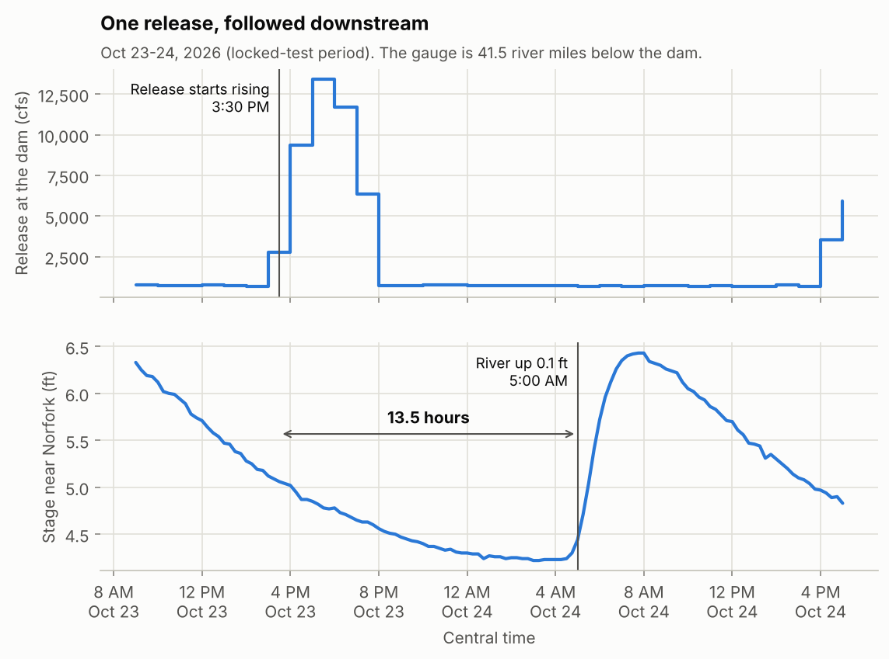
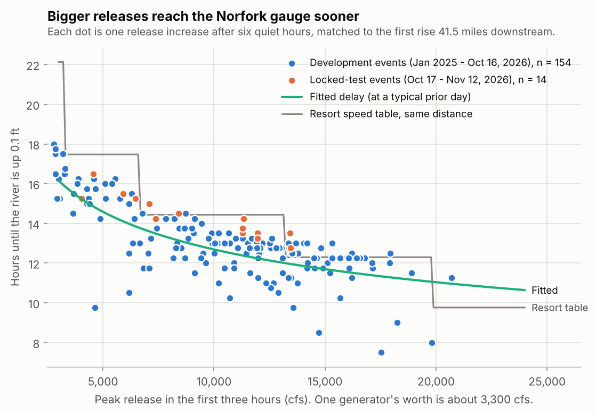
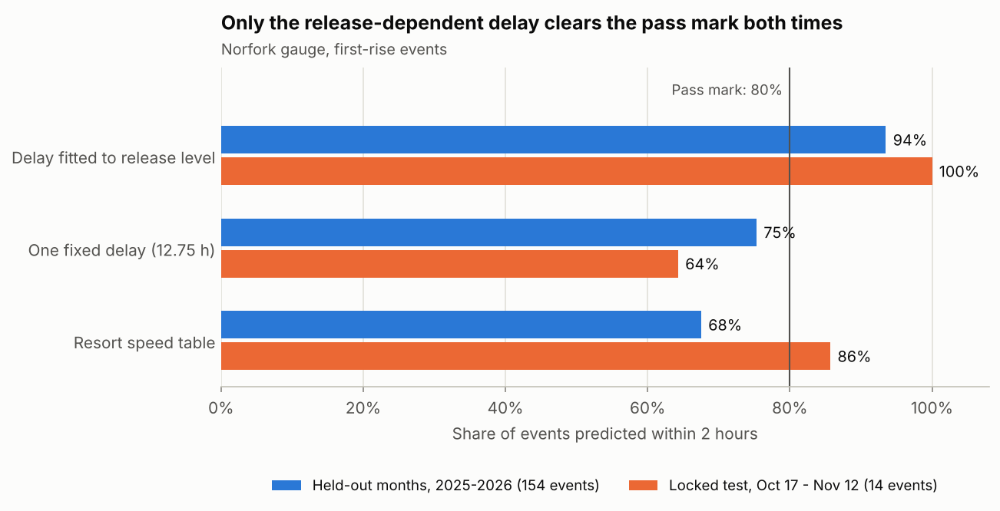
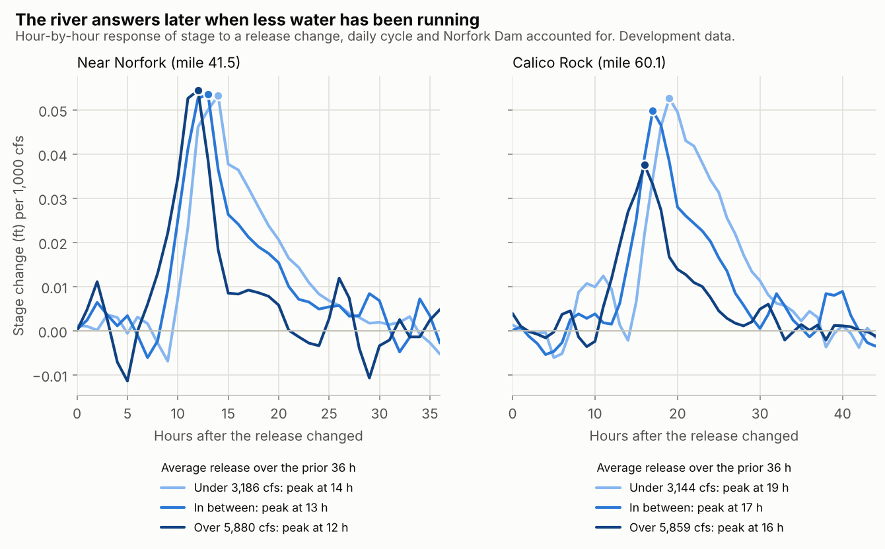
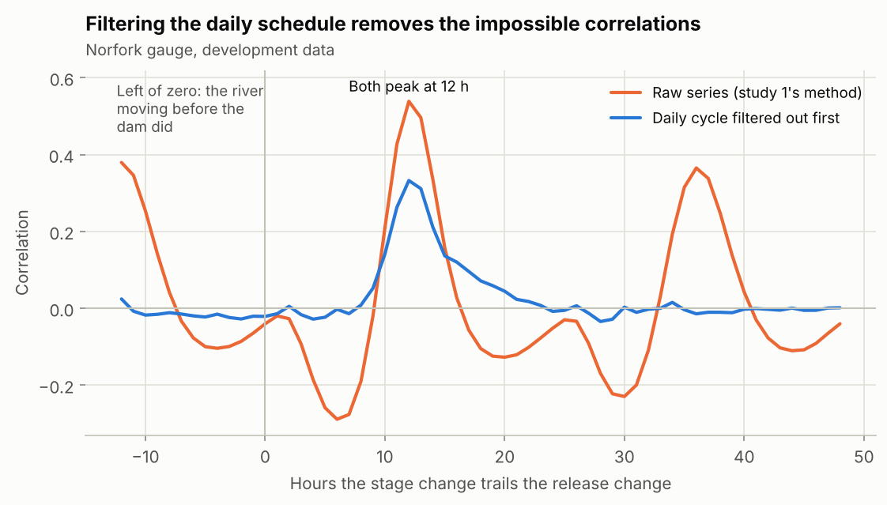

# Bull Shoals release vs downstream gauges, study 2 (2026-11-12)

Research only. Nothing here is wired into the app, and no number in this
folder is approved for display. It is the measurement that
[TAILWATER_PLAN.md §1](../../../docs/TAILWATER_PLAN.md#1-travel-time-lag--learn-it-do-not-assume-it)
asks for before any arrival estimate is designed.

**Question.** After Bull Shoals Dam raises its release, when does the White
River start to rise at the two downstream USGS gauges, how does that delay
change with release level, and is it predictable to within a stated number of
hours?

**Rules were fixed first.** [protocol.json](protocol.json), the analysis code
and its tests were committed (`375cda6ea`) before any real release or stage
value was analysed. The pass marks below come from that file.

## Result

| Gauge | Verdict | Why |
| --- | --- | --- |
| White River near Norfork (USGS 07057370, mile 41.5) | **Supported** | First-rise events and lag stability both pass |
| White River at Calico Rock (USGS 07060500, mile 60.1) | **Inconclusive** | Lag stability passes, but Norfork Dam moves during almost every event, leaving too few clean ones to score |

"Supported" means a release-dependent first-rise range at that gauge is
defensible as a labelled estimate. It is not a wading or launch window, and it
says nothing about accesses that have no gauge.

Study 1's finding is reproduced: one fixed delay does not hold up. The delay
depends on how much water is running, and a model that allows for that passes.

## Data

- Hourly total release at Bull Shoals and Norfork dams from the Corps' public
  CWMS API; 15-minute stage at both gauges and discharge on the Buffalo River
  and Crooked Creek from the public USGS service.
- 2025-01-01 to 2026-11-12 18:00 UTC: 16,338 hours.
- Development period: 2025-01-01 to 2026-10-16. Locked test: 2026-10-17 to
  2026-11-12, all of it after study 1 was reviewed. The test was scored once.
- The snapshot is committed under [data/](data/) (about 0.7 MB) because recent
  USGS values are provisional and can be revised.

## Part A: first rise after a release increase (Norfork gauge)

An event is a release increase of at least 2,000 cfs after six steady hours,
matched to the first time the gauge is 0.10 ft above its three-hour low. Rain
periods and gauge gaps are dropped; a match must be unambiguous.



| Step | Development | Locked test |
| --- | ---: | ---: |
| Release increases found | 244 | 17 |
| Dropped: gauge gap | 22 | 0 |
| Dropped: tributary moving | 49 | 0 |
| Dropped: ambiguous match | 19 | 3 |
| No rise found at the gauge | 0 | 0 |
| **Events scored** | **154** | **14** |

Every eligible increase produced a rise at the gauge. The median delay was
12.75 hours (middle 80% of events: 11.25 to 15.9 hours).

| Peak release in first 3 hours | Events | Median delay |
| --- | ---: | ---: |
| Under 8,700 cfs | 51 | 15.0 h |
| 8,700 to 12,800 cfs | 51 | 12.75 h |
| Over 12,800 cfs | 52 | 12.25 h |



Three ways of predicting the delay, scored the same way. The pass mark was 80%
of events within 2 hours, on held-out months and on the locked test.

| Prediction | Held-out months (154) | Locked test (14) | 80% of held-out events within |
| --- | ---: | ---: | ---: |
| Delay fitted to release level | **94%** | **100%** | 1.3 h |
| One fixed delay (12.75 h) | 75% | 64% | 2.5 h |
| Resort speed table | 68% | 86% | 2.8 h |



The fitted model is `ln(hours) = 4.719 - 0.040 ln(q24) - 0.201 ln(qpeak)`,
where `q24` is the average release over the previous 24 hours and `qpeak` the
peak in the first three. With a prior-day average of 3,000 cfs it gives:

| Peak release | About | Predicted delay |
| --- | --- | ---: |
| 3,300 cfs | 1 generator's worth | 15.9 h |
| 6,600 cfs | 2 | 13.8 h |
| 13,200 cfs | 4 | 12.0 h |
| 26,400 cfs | 8 (extrapolated: only 2 events above 6) | 10.5 h |

On held-out months, 90% of events fell within 1.8 hours of the fitted
prediction.

**The resort speed table runs late at this gauge.** Applied over 41.5 miles it
predicted the rise 1.75 hours later than it arrived on average, and about 3.5
hours later at up to two generators' worth. Late is the unsafe direction. The
"Release Arrival Ranges" prototype is built on that table.

## Part B: hour-by-hour response (both gauges)

Study 1 correlated the raw series, which mostly picked up the dam's daily
schedule. Here stage change is regressed on release changes at every lag at
once, which separates the response from the schedule, and Norfork Dam's
release is a separate input at Calico Rock.



| Average release, prior 36 h | Norfork gauge: first response / peak | Calico Rock: first response / peak |
| --- | --- | --- |
| Under about 3,200 cfs | 11 h / 14 h (12 to 14) | 16 h / 19 h (18 to 20) |
| 3,200 to 5,900 cfs | 10 h / 13 h (12 to 13) | 14 h / 17 h (17 to 18) |
| Over 5,900 cfs | 9 h / 12 h (11 to 12) | 12 h / 16 h (16 to 17) |

Brackets are 95% bootstrap intervals for the peak. Norfork Dam's own release
peaks at Calico Rock 5 to 6 hours later, which matches the guide report of
about 5 hours.

Predicting hourly stage change in the locked test from development
coefficients:

| | Norfork gauge | Calico Rock |
| --- | --- | --- |
| Release-dependent response, r (95% interval) | 0.60 (0.49 to 0.67) | 0.52 (0.38 to 0.64) |
| One pooled response, r | 0.22 (0.01 to 0.36) | -0.04 (-0.23 to 0.13) |
| Shift that fits the test best | 1 h later (r 0.73) | 2 h later (r 0.72) |
| Lag-stability pass mark | within 2 h: **pass** | within 3 h: **pass** |

The pooled response is study 1's fixed lag, and it fails on later weeks here
just as it did there.



Cross-check: after filtering the daily cycle out, the cross-correlation still
peaks at 12 h (Norfork gauge) and 18 h (Calico Rock), and the correlations at
impossible negative lags fall from about 70% of the peak to under 10%.

## Calico Rock events

Only 11 development events and no locked-test events were clean, because
Norfork Dam's release moved during 171 of 244 development events and all 17
test events. Those 11 had a median delay of 17.5 hours. That is too few to
score, so the gauge is inconclusive rather than failed.

## Falling water (descriptive, no pass mark)

At the Norfork gauge the river began to drop a median of 10.0 hours after a
release cut (12.0, 10.25 and 9.0 hours from low to high starting level; 63
matched events, with 263 more left out as ambiguous). This is when the drop
**starts**. It does not measure how long the river takes to come down.

## Limits

- **The locked test covers one kind of water.** It has 14 events, none above
  13,440 cfs, and 592 of its 636 hours fall in the low-release group. High
  releases are validated only by the held-out months.
- **The river ran a little later than predicted in the test.** Events arrived
  0.8 hours later than predicted on average, and the best-fitting shift was 1
  hour later at the Norfork gauge and 2 hours at Calico Rock. Both are inside
  the tolerance, but the direction is consistent: the model understates how
  much the river slows after very low releases.
- **Some rises come early.** On held-out months, 7 of 154 events arrived more
  than 2 hours before the prediction, the worst by 5.5 hours; 3 arrived more
  than 2 hours late. A displayed range would need its early edge set from
  those, not from the average. Looked at afterwards (post hoc, by hand): three
  of the seven came when the dam had already run 11,000 to 20,000 cfs for a
  day and the gauge stood near 9 to 10 ft, and the rise took about 8 hours.
  The other four were at low water with dry tributaries, and each followed a
  small release bump 8 to 9 hours earlier that was below the event threshold;
  the rise that was matched is most likely that bump arriving (about 18.5
  hours after it on three consecutive days), not the main release. No
  rainfall data is in the study; tributary flow is the only weather signal.
- **Only clean starts were scored.** Part A needs six steady hours before the
  increase. Stacked or stepped generation is covered by Part B only.
- **Nothing is measured between the dam and mile 41.5.** USGS has no stage
  gauge there, so White Hole, Wildcat Shoals, Cotter, Rim Shoals and Buffalo
  City are untested. Scaling this delay by distance is an assumption.
- **Rain periods are excluded.** Results describe a river whose tributaries
  are not moving.
- **Timing precision.** Releases are hourly means, so an onset is known to
  about 0.6 hours. If the Corps series were not period-ending, as the repo
  verified in August, every delay here would shift by one hour.
- **Study 1's exact dates are inferred.** Its files are not in the repo. The
  locked test starts the day after its review, so the two cannot overlap.

## Deviations from the protocol

None in the analysis. Two things changed after the lock, neither affecting a
result: the snapshot files were switched to gzip, and
[exploratory.py](exploratory.py) was added after the results were seen. Its
output ([results/exploratory.json](results/exploratory.json)) is labelled post
hoc: the direction of misses and the resort-table error by generator count
quoted above come from it, and it shows the median delay moves only from 12.5
to 13.0 hours when the arrival mark is 0.05 or 0.20 ft instead of 0.10 ft.

## Reproduce

```bash
python3 -m venv .venv && .venv/bin/pip install -r requirements.txt
```

```bash
.venv/bin/python -m pytest test_lagstudy.py
```

```bash
.venv/bin/python run_study.py && .venv/bin/python make_figures.py && .venv/bin/python exploratory.py
```

`run_study.py` reads the committed snapshot. `fetch_data.py` downloads a fresh
one (no credentials); newer data will change the locked-test numbers. The
tests are not part of `make check`, which has no Python step.

## Files

| File | What it is |
| --- | --- |
| `protocol.json` | The locked rules, thresholds and pass marks |
| `lagstudy.py` | Analysis functions |
| `test_lagstudy.py` | Checks on synthetic rivers with known answers |
| `fetch_data.py`, `data/` | Public-source download and the snapshot used |
| `run_study.py`, `results/results.json` | The locked run and every number above |
| `results/events_*.csv` | Each release change, its match and any exclusion |
| `make_figures.py`, `results/fig*.png` | Figures |
| `exploratory.py`, `results/exploratory.json` | Post hoc checks |
