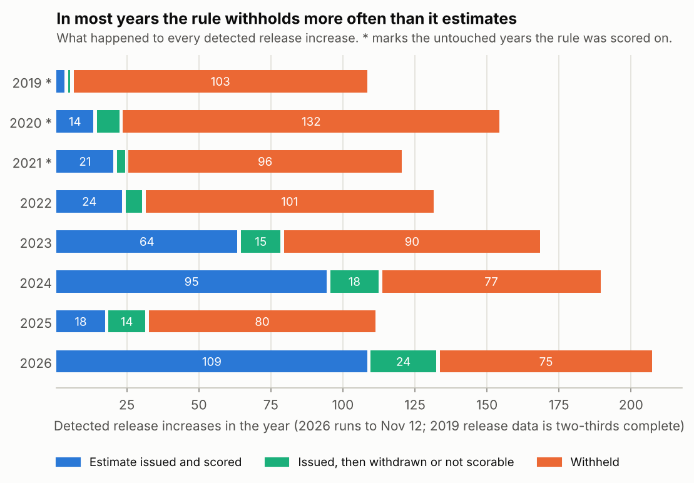

# Replay: an at-the-time estimate for the Norfork gauge (2026-11-12)

Research only. Follows [study 2](README.md) and [study 3](STUDY3.md); nothing
here is approved for display.

**Question.** Using only readings available when a release increase is three
hours old, how often could Eddy issue an arrival estimate for the gauge near
Norfork, and how good would it be?

**How it was kept honest.** The rule, the model and the display range were set
on 2022-2026, which had all been analysed, and committed with the pass marks
([protocol_replay.json](protocol_replay.json), `4d0210830`). Then 2019-2021
was downloaded and scored once. Release data does not exist before 2018, so
this was the last untouched history.

## Result: inconclusive, and not encouraging on early arrivals

Only 39 estimates could be scored in 2019-2021. The pass marks needed 60.

| Pre-set mark | Needed | Got (39 estimates) | Plausible range at this sample size |
| --- | ---: | ---: | --- |
| Within 2 hours of the estimate | 80% or more | 90% (35) | 76 to 97% |
| More than 2 hours early | 5% or less | 8% (3) | 2 to 21% |
| Inside the displayed range | 90% or more | 87% (34) | 73 to 96% |
| Before the range's early edge | 5% or less | 8% (3) | 2 to 21% |

Taken at face value, accuracy clears its mark and the other three miss. With
39 events none of that is settled either way. The rule also did worse here
than on the years it was built on (98% within 2 hours, 2% early), which is
the usual result of checking a rule on new data.

## How often the rule could speak

| | 2019-2021 (untouched) | 2022-2026 (rule built here) |
| --- | ---: | ---: |
| Detected release increases | 385 | 811 |
| Withheld | 331 (86%) | 423 (52%) |
| Issued and scored | 39 (10%) | 310 (38%) |
| Issued, then withdrawn before the rise | 4 | 23 |
| Issued, outcome not determined | 11 | 55 |



Reasons for withholding in 2019-2021: release already raised (177), increase
under 2,000 cfs (103), river high (45), tributaries moving (4), a smaller
increase first (2). Those were high-water years, with the gauge typically at
7.5 to 9 ft before an increase. The share of increases that got a scored
estimate ranged from 4% in 2019 to 52% in 2026.

## What the estimate looks like when it is issued

- **The rule:** a release increase of at least 2,000 cfs from a baseline under
  1,500 cfs, no smaller increase in the previous 20 hours, gauge under 7 ft,
  tributaries steady over the 12 hours up to the decision.
- **The estimate:** `ln(hours) = 4.2145 - 0.1633 ln(three-hour peak) - 0.0231 x gauge height`,
  shown as 1.5 hours earlier to 1.25 hours later than that.
- **Lead time:** the estimate goes out three hours into the release. In
  2019-2021 the rise followed a median 10 hours later; 8 hours if release data
  arrives 2 hours late, 5 hours if it arrives 5 hours late.

## The four large misses (looked at afterwards)

Hand inspection after scoring; these are observations, not corrections to the
score.

| Date | Estimate | First 0.1 ft rise | What the hydrograph shows |
| --- | ---: | ---: | --- |
| 2020-12-28 | 13.2 h | 5.0 h | A small earlier pulse that had already ended reached the gauge first. The main rise came at about 13 h. |
| 2021-02-22 | 15.4 h | 12.75 h | Tributaries climbing slowly lifted the gauge. The release's rise came at about 15 h. |
| 2021-12-17 | 13.7 h | 11.25 h | Two inches of rain the next day. The release's rise came at about 14.5 h. |
| 2020-11-05 | 14.5 h | 20.5 h | The release record reads 0 cfs for the hours before, while the gauge stood at 6.9 ft. Probably bad release data. |

In all three early cases the release's own sharp rise arrived close to the
estimate, and something else moved the gauge 0.1 ft first. The pre-set
outcome counts those as misses, and that stands. It does show the scoring
mixes two questions: when the release arrives, and when the river first rises
for any reason.

## Other checks

- **Counting every first rise, matched or not** (51 estimates): 90% within 2
  hours, 8% more than 2 hours early, 84% inside the range. The ambiguous
  cases were not hiding a much worse picture.
- **The watch did not earn its place.** It withdrew 4 estimates; the 3 with a
  known outcome would all have been within 2 hours. With the watch off the
  scores are about the same.
- **The gauge reads the same across periods:** 4.92 ft against 5.03 ft at the
  same flow.

## What this means

- The replay does not confirm the rule. It does not refute it either.
- There is no more untouched history at this gauge. The remaining honest test
  is the forward log: predictions saved before the outcome exists.
- At these rates the forward log would collect roughly 15 to 110 scored
  estimates a year, depending on how wet the year is.
- Three changes are worth fixing in advance for that log, since each came out
  of this run: record the release's main rise as a second outcome beside the
  first 0.1 ft rise; treat an earlier pulse that has already ended as a reason
  to withhold; and reject implausible release readings such as 0 cfs.

## Limits

- Real publication delays were assumed, not replayed.
- No rain forecast or hourly rain was available historically, so the rule
  cannot see rain coming.
- The thresholds (1,500 cfs, 7 ft) came from study 3's results on 2022-2024,
  which sit inside this replay's development period.
- Still one gauge, 41.5 miles down.

## Reproduce

```bash
.venv/bin/python run_replay.py freeze
```

```bash
.venv/bin/python run_replay.py score && .venv/bin/python replay_figures.py
```
