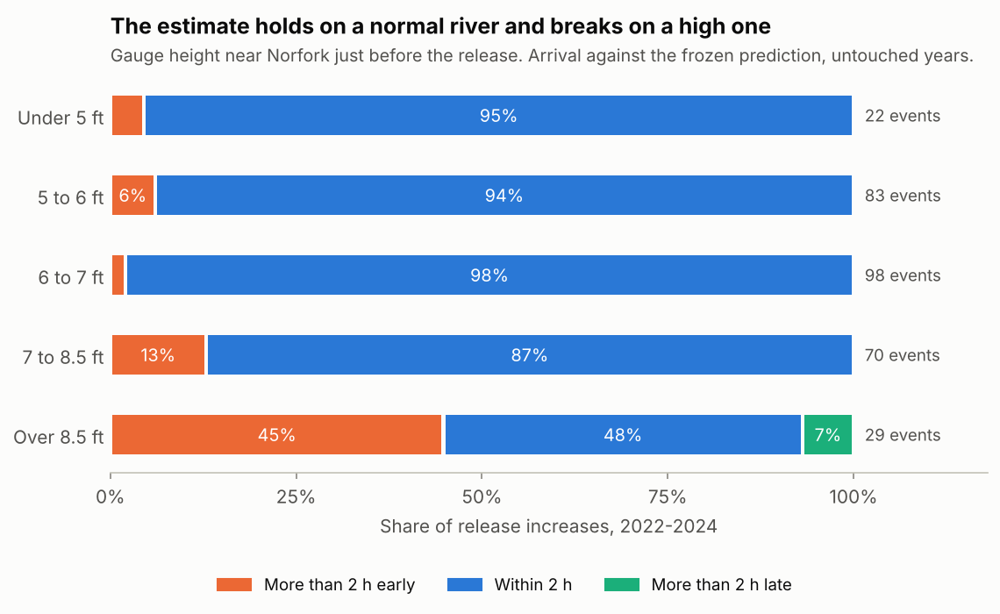
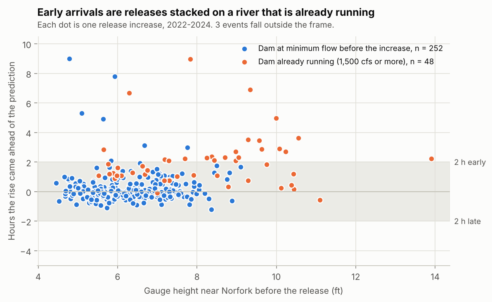

# Study 3: river height, weather and stepped releases (2026-11-12)

Research only, like [study 2](README.md). Nothing here is approved for display.

**Question.** Do river height and wet weather change the delay to first rise
near Norfork, does allowing for them hold up on years no analysis has touched,
and what happens when a small release bump goes first?

**How it was kept honest.** Study 2's data (2025-2026) had all been looked at,
so the models were chosen and frozen on it, the rules and pass marks were
committed ([protocol_conditions.json](protocol_conditions.json), `30b2e778f`),
and only then were 2022-2024 downloaded and scored, once.

## Result

**The blanket estimate does not hold. A conditional one does.**

| Pre-set pass mark, 302 release increases in 2022-2024 | Needed | Got |
| --- | ---: | ---: |
| Within 2 hours of the prediction | 80% or more | **89%** |
| Arriving more than 2 hours early | 5% or less | **10%**, so it fails |

The typical miss was 0.4 hours, so the estimate is usually very good. The
failures are concentrated, and they are almost all in the early direction.



| Gauge height before the release | Events | Within 2 h | More than 2 h early | Median delay |
| --- | ---: | ---: | ---: | ---: |
| Under 5 ft | 22 | 95% | 5% | 14.1 h |
| 5 to 6 ft | 83 | 94% | 6% | 13.5 h |
| 6 to 7 ft | 98 | 98% | 2% | 13.0 h |
| 7 to 8.5 ft | 70 | 87% | 13% | 13.25 h |
| Over 8.5 ft | 29 | 48% | 45% | 9.4 h |

These bands were fixed before scoring. Below 7 ft the estimate is reliable.
Above 8.5 ft the river answers about four hours sooner and the estimate is
wrong nearly half the time.

## Weather

| Label (fixed before scoring) | Events | Within 2 h | More than 2 h early |
| --- | ---: | ---: | ---: |
| Tributaries steady | 259 | 91% | 8% |
| Tributaries moving | 43 | 79% | 19% |
| Under 0.5 inch of rain over four days | 205 | 91% | 8% |
| 0.5 inch or more | 97 | 86% | 13% |

Rain matters less than river height. It hurts mainly when it has reached the
river, which is what moving tributaries show. By year: 2022, a high-water
year, scored 74%; 2023 scored 92% and 2024 95%.

## Putting river height into the formula did not fix it

| Model, same 302 events | Within 2 h | More than 2 h early |
| --- | ---: | ---: |
| Conditions model (release size, gauge height, tributary flow) | 89% | 10% |
| Study 2 model (release size, prior-day release) | 89% | 10% |
| Release size and gauge height | 91% | 9% |
| Release size and gauge flow | 91% | 9% |

A high river is a different regime, not a small adjustment to the same curve.
The gauge's stage reading is comparable across the two periods (5.03 ft
against 5.09 ft at the same flow), so this is not a gauge artefact.

## What separates the misses (post hoc)

These cuts were made after seeing the results above. They describe this data
and are not validated rules.



| Cut | Events | Within 2 h | More than 2 h early |
| --- | ---: | ---: | ---: |
| Dam at minimum flow before the increase | 254 | 96% | 3% |
| Dam already running 1,500 cfs or more | 48 | 54% | 46% |
| Dam already running 3,000 cfs or more | 20 | 10% | 90% |
| Gauge under 7 ft, tributaries steady | 189 | 98% | 2% |
| Same, and under 0.5 inch of rain | 138 | 99% | 1% |
| Gauge under 7 ft, tributaries moving | 14 | 71% | 29% |

The sharpest split is whether the dam was already generating. An increase
stacked on a running river reached the gauge in about 8 hours, where the same
increase from minimum flow takes about 13. About six in ten scored releases
met the "normal" conditions: dam at minimum flow, gauge under 7 ft, tributaries
steady.

## Stepped releases: a small bump, then the main increase

A release was labelled stepped when a smaller increase of 500 cfs or more went
first in the previous 20 hours. These were scored separately.

| | 2025-2026 (16 events) | 2022-2024 (26 events) |
| --- | ---: | ---: |
| Gap between bump and main increase at the dam | 9 h (7 to 14) | 10 h (6 to 17) |
| Gap between first rise and steepest rise at the gauge | 1.25 h (0.75 to 4.4) | 1.1 h (-5 to 6) |
| First rise against a no-bump prediction | 1.6 h earlier | 1.6 h earlier |
| Steepest rise against expected | 0.9 h earlier | 1.4 h earlier |

Brackets are the middle 80%. Two things follow:

- **The gap closes on the way down.** The small bump travels slowly and the
  main surge travels fast, so two increases 9 or 10 hours apart at the dam are
  usually about an hour apart 41.5 miles down. Nearer the dam they would still
  be well apart; that is not measured.
- **Everything runs about an hour and a half early on these days,** and the
  scatter is wide. A stepped day should be treated as lower confidence.

## What this supports

- An estimate near Norfork in **normal conditions** (dam at minimum flow
  before the release, gauge under 7 ft, tributaries steady) is well supported:
  three untouched years at 94 to 98% within 2 hours by pre-set height bands.
- Outside those conditions the estimate should not be shown as usual. The
  river is faster, and the error is in the early direction.
- Eddy already has every input for that gate live: the release, the gauge
  height and the tributary gauges.

## Limits

- The gate (minimum flow, 7 ft, steady tributaries) was found after scoring.
  The height bands behind it were pre-set, but the combined rule needs its own
  check on new data before it is relied on.
- 75 of 432 release increases had an ambiguous match and were left out. They
  are the busiest days, so real-world reliability is probably lower than these
  figures on days with several releases.
- High-river events are few (29 above 8.5 ft), so there is not enough to build
  a separate high-water estimate yet.
- Still one gauge, 41.5 miles down. Nothing here tests Cotter or Rim Shoals.
- Rainfall is a daily average of station totals over a wide box, which is
  coarse. Tributary flow is the better signal and is what the labels lean on.

## Deviations

None. [explore_conditions.py](explore_conditions.py) and its figures were
added after scoring and are labelled post hoc.

## Reproduce

```bash
.venv/bin/python run_conditions.py freeze
```

```bash
.venv/bin/python run_conditions.py score && .venv/bin/python explore_conditions.py
```

Both read the committed snapshots under `data_conditions/`.
`fetch_conditions.py` downloads fresh ones from the Corps, USGS and NOAA ACIS.
